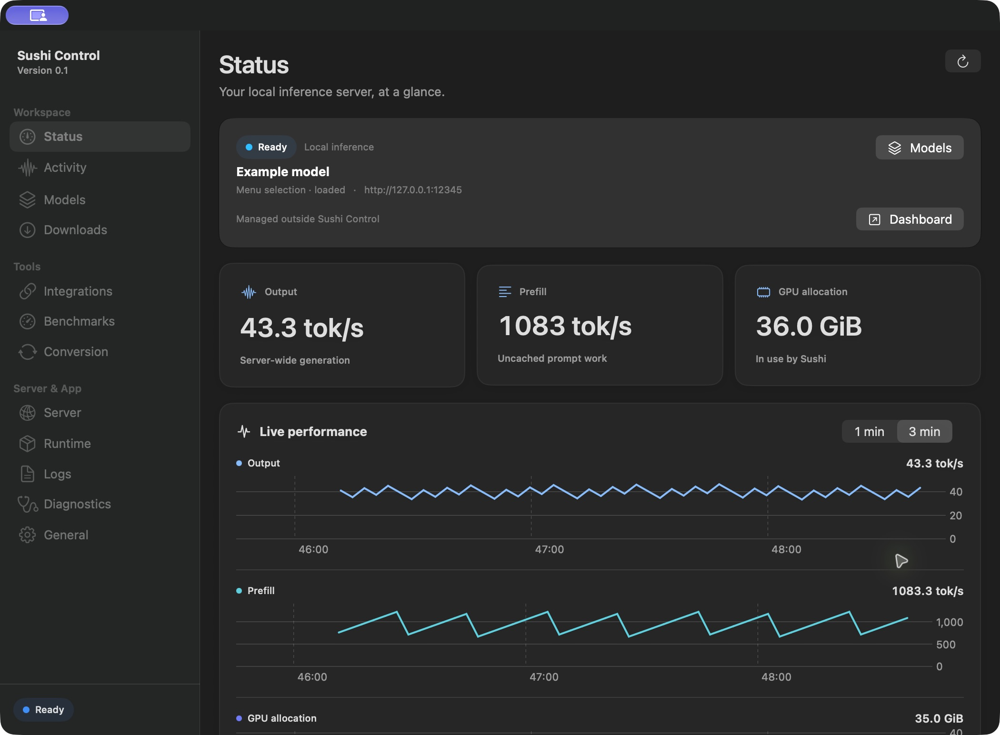
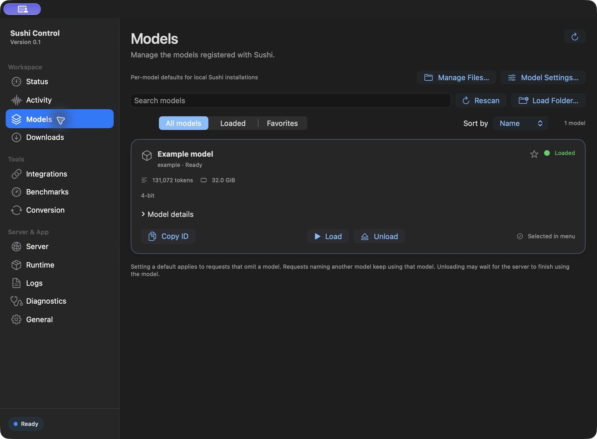
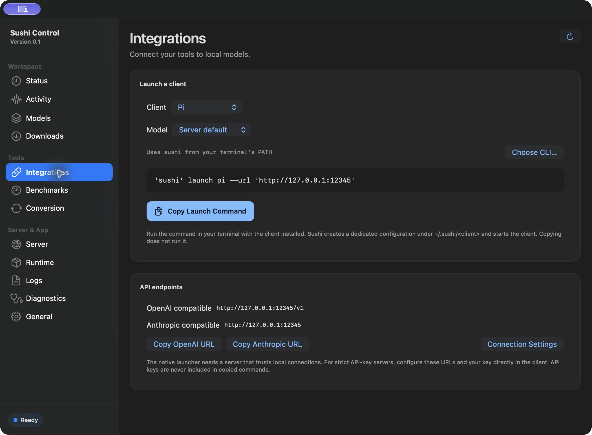

# Sushi Control for macOS

Sushi Control is a native macOS companion for [Sushi](https://github.com/beamivalice/sushi) that monitors and controls your local inference server. It provides a menu-bar companion, model management, performance charts and client integrations.

Sushi and model weights are installed separately. The app works with a standard Sushi server without a separate controller or modified engine.

## Screenshots

These views use an example model and simulated performance data.



| Model library | Client integrations |
| --- | --- |
|  |  |

## Requirements

- An Apple Silicon Mac running macOS 14 or later. Sushi and individual models have their own requirements.
- To build from source: Xcode 26 or newer with its command-line tools, Python 3 and Git. Building an app for distribution also uses the macOS `ditto` and `codesign` tools.
- A separately installed [Sushi](https://github.com/beamivalice/sushi) server and model if you want to run inference. A server is not needed for the default offline tests or to build the app.

## Build and connect

```sh
git clone https://github.com/sudo-holla/sushi-control.git
cd sushi-control
./macos/test.sh
./macos/build.sh
open "macos/build/Sushi Control.app"
```

The build script prints the resulting app path. If the checkout is in an iCloud-managed folder, use a temporary build directory to avoid Finder metadata invalidating signatures:

```sh
BUILD_DIR="${TMPDIR:-/tmp}/sushi-control-build" ./macos/build.sh
```

In **Server**, enter your running server's local HTTP root and choose **Save & Connect**. The app initially suggests `http://127.0.0.1:12345`; use the actual port configured for your server. Only loopback roots are accepted, with no path such as `/v1`. Supply an API key if your server requires one. Keys stay in memory unless you explicitly save a profile with **Remember API key in Keychain** enabled. Stock Sushi trusts loopback unless launched with `--api-key-strict`.

To create local app and source ZIPs, run `python3 package.py`; the files and checksums are written to `dist/`. The default app build is ad-hoc signed and is not notarized. This repository does not currently provide a prebuilt GitHub release.

For setup and feature details, see [Controls](#controls), [Security and privacy](#security-and-privacy), [Compatibility checks](#compatibility-checks), and [Contributing](CONTRIBUTING.md). Report vulnerabilities using the private process in [SECURITY.md](SECURITY.md).

## Controls

- Status and models use `/v1/models` and `/props`; polling never loads a model.
- Load sends `/v1/load-model` with `model` and `default:true`; unload uses `/v1/unload-model`; Rescan uses `/v1/models/rescan`.
- The dashboard puts server state, the selected model, output speed, prefill speed and GPU allocation first. Its output, prefill and GPU graphs share a one-minute or three-minute time window; hover or click to inspect an actual sample. Missing samples break the line rather than implying continuous activity. Activity shows running requests and cached conversations with context, generated tokens and KV memory. Model cards show context, resident memory and quantization where available. Expand Model details for reported capabilities, input types, reasoning levels, context ceiling, disk size, KV format and DFlash/MTP state. The Status page shows RAM cache budget and SSD cache usage for the server’s default model when provided. Logs can be filtered by text.
- Status includes system-wide CPU and GPU utilization, GPU model/core count, physical/wired/compressed memory, thermal state and Mac uptime from macOS. GPU utilization comes directly from the local accelerator registry and remains separate from Sushi’s GPU memory allocation; unavailable readings show a dash. These measurements stay available while the server sleeps. Serving statistics show token totals, request outcomes, cache efficiency, completed-request prefill/decode speeds and mean time to first token; export the snapshot as CSV. Prefill speed excludes restored cache tokens. Reset stats starts an app-local window dated from the press: the panel, its trend charts and the CSV export then cover only activity since that reset, the snapshot survives app restarts, and Show server totals returns the lifetime view. The reset is local to this app because standard Sushi has no statistics-reset endpoint—the server keeps counting from its own start—so a server restart, where counters move backwards, discards the stale window and shows lifetime totals again.
- The live performance view separates output throughput, prefill speed and GPU allocation. Prefill uses changes in the server’s `prefill_tokens_live` gauge between polls, handles new-prompt counter resets, and excludes restored prefix tokens. Idle periods decay to zero; servers without this gauge show an unavailable message. Brief metrics failures preserve chart history and leave a gap until sampling resumes. Serving Statistics retains completed-request speed averages.
- On macOS 26 or later, the main window’s server panel and menu-bar server controls use native Liquid Glass. Older systems, Reduce Transparency and increased contrast use an opaque surface; charts retain solid backgrounds.
- Statistics use `/metrics.json`. Without `--metrics`, model controls still work and missing statistics show a dash.
- Start an optional app-managed process by choosing a Sushi executable and supplying its arguments as a JSON array. No shell is invoked; paths must be absolute and `~` is not expanded.
- Stop and Restart require confirmation because they can interrupt requests. App-managed servers use a dedicated launchd job. Alternatively, choose Use Existing Launch Agent in Server to explicitly control an existing user launch agent. Its Label and executable are validated; the source plist is preserved, rechecked before restart, and never overwritten. Detaching leaves its server running. Launch settings remain controlled by that file while attached. The selected launcher is remembered after reopening the app.
- Standard Sushi has no request-admission pause endpoint. Pause is explicitly unavailable; the app does not suspend inference processes.
- The launch form prepares arguments for port, model folder, context, resident model memory, idle eviction, KV width and metrics. Press Use These Launch Settings, inspect the advanced arguments, then Save & Connect; the running server is unaffected until restart. Other cache and decoding settings remain available through advanced arguments.
- Context, memory, cache, idle eviction and decoding settings are launch flags supported by the chosen binary. The app imposes no hardware-specific defaults or caps. Launch settings can be edited while the managed server runs. Restart validates the new settings before stopping the server, then applies them. Connection profiles stay locked until the service is stopped.
- Integrations generates shell-quoted native launch commands for Pi, Hermes, Claude Code, OpenCode, Codex, Oh My Pi, Aider, ZCode and Grok CLI, with optional model selection and OpenAI/Anthropic endpoint copying. Copying never runs a command or embeds API keys. Native launchers require loopback trust; strict API-key clients need direct configuration. Available launch targets depend on the installed Sushi version.
- Menu controls group the overview, model actions and server actions into separate sections, with a fixed footer for the main window, dashboard, refresh and quit. The overview shows the selected model and live output/prefill speeds, followed by a shared one-minute chart with independently scaled lines. GPU allocation, active requests and cache reuse can be selected as additional metrics. The menu-bar title can show active requests, output speed, GPU allocation or just the template sushi icon. Updates follow store changes and the selected polling interval. The menu panel fits short content and scrolls when needed. Favorites-only mode keeps the selected and loaded models available; preferences persist, including migration of the earlier request-count toggle.
- A first-run guide offers connection, launch-agent, launcher, CLI and model-library shortcuts. Common CLI locations are inspected without executing them; version checks are explicit. Existing configurations suppress the automatic guide, and General can reopen it. Dismissal is remembered. The guide does not install, download or start services automatically.
- Model Settings edits standard Sushi’s local `~/.sushi/model-settings.json` for an explicitly selected model folder or GGUF file. It offers context, KV width, MTP, vision, thinking preservation, thinking penalty, MTP acceptance/greedy tail and expert-streaming SSD budget, preserves other keys/models, backs up existing bytes and refuses a save after external edits. Explicit launch flags take precedence; saving does not reload or restart a model.
- Model details show model-author temperature, top-p and top-k when reported by Sushi. The app does not treat these as the effective request settings. About includes bundled MIT/Apache licenses, third-party notices and project/documentation links, accessible from the application menu or General.
- Benchmarks send bounded non-streaming chat requests with unique or repeated prompts, selected output limits, 1–5 runs and per-request deadlines. Results separate cache-adjusted server prefill/decode timing from end-to-end speed, retain pre-run model metadata, persist up to 100 records and export JSON without prompts, response text or API keys. Server operations are guarded while a benchmark runs; cancellation ends the active request.
- Conversion uses the selected CLI’s native `convert exl3` command after checking its help output for support. Codebook arguments follow the selected CLI’s advertised syntax, including older `--codebook` and newer `--expert-codebook` releases. Source/output folders, expert rate, calibration, trunk, codebook, search window and factor precision are configurable and remembered. Validation refuses overlapping source/output paths and non-empty new outputs; resume is explicit. Conversion requires the configured server to be stopped, has a selected deadline and cancellation, and guards server/model operations while running. Task output/history is shared with Downloads and Runtime. Checkpoint support remains the converter’s responsibility.
- Downloads and Runtime have a separate CLI selector, independent of the selected server launcher. Downloads runs `sushi list` and `sushi pull` with searchable pack cards from the CLI catalog, per-file progress, cancellation and a selected time limit. Recent tasks retain the last 20 results across app restarts, with log access and explicit resume actions for interrupted downloads. A bounded 20-item download queue supports ordering, removal and pause-after-current; each item keeps its chosen CLI and deadline, and failure or cancellation pauses subsequent downloads. Queue and recent history are saved atomically in Application Support with private file permissions. Restored queues always stay paused, including interrupted downloads; no task starts automatically on app launch. Raw CLI output remains available when catalog or progress formats are unrecognized. Tasks stop if captured output exceeds 16 MiB; unrelated app file descriptors are closed in child processes. Runtime controls report the installed version, check for updates and invoke Sushi’s own updater after confirmation. Updates are disabled while connected to a running server, and server lifecycle/model actions stay disabled during runtime replacement.
- Success notices can be dismissed and expire after ten seconds; automatic expiry is disabled while VoiceOver is active. Errors stay visible until dismissed or resolved.
- Appearance follows System, Light or Dark; the menu bar icon remains a macOS template image. Refresh intervals (2, 3, 5 or 10 seconds) and keeping the Dock icon visible are saved preferences.
- Star favorite models, filter All/Loaded/Favorites, sort by name, resident memory or context, and copy model IDs. Favorites and sorting persist across app restarts. A menu-bar preference shows favorites while always retaining loaded models.
- Search the model library by name, architecture or quantization, choose a model directly from the menu, copy the API URL and reveal app-managed logs in Finder. Status badges and progress messages show connection and action state.
- Closing the window leaves the menu bar item running. Quitting leaves Sushi running; reopening reconnects to the app-managed service or attaches to an external server. Login startup is opt-in.

For launchd management, use an installed runtime outside protected Documents/Desktop folders; macOS privacy checks can block a developer checkout before its server log opens.

The runtime and model are not bundled. Builds enable hardened runtime and use ad-hoc signing by default. Set `SIGNING_IDENTITY` to a Developer ID Application identity when running the build or packaging script to add Developer ID signing and a secure timestamp. Packaging verifies the extracted signature and records the signing mode in its manifest. Notarization and stapling must be completed separately before distribution; the packaging script does not submit files to Apple.

Named connection profiles save endpoint and launch settings. Optional API keys are stored in Keychain, separately from profile data. Diagnostics tests server endpoints without loading a model and exports a report with the configured API key redacted.

## Security and privacy

The app links only Apple system frameworks; it does not bundle third-party runtime packages or an inference engine. Keep macOS current for framework security updates. CLI execution uses an explicitly selected executable and argument arrays without a shell; install Sushi from a trusted source. Runtime updates and model downloads are performed by that executable, under your user account.

Inference and controller requests accept loopback HTTP roots only, refuse redirects and bypass proxies, cookies, shared credentials and caches. Responses are capped at 8 MiB, including bodies without a declared length. Status requests have a 15-second total deadline; other requests default to 180 seconds, with explicit benchmark deadlines up to 600 seconds. Error text is bounded and the request's API key is redacted before display.

Connection keys are kept in memory or explicitly saved to this device's unlocked Keychain. Arguments entered in advanced server settings are configuration, not Keychain secrets: inline credentials in those arguments also appear in the launch configuration. Application-created task logs and history use private file permissions; review logs and exports before sharing them. The app is not sandboxed because it manages selected executables, launch agents and model files; it does not request administrator privileges. Developer ID signing and notarization remain separate distribution steps.

Publisher browsing is an explicit feature that sends the entered search terms to Hugging Face and fetches public model metadata. The selected Sushi executable performs model downloads and runtime updates when requested; these operations can contact external services. That executable runs under your user account and normally inherits the app's environment, so use a trusted binary and avoid placing secrets in launch arguments or environment variables unnecessarily. Opening project links uses your browser.

The app stores preferences and connection profiles locally. Benchmark, task and optional usage history live under `~/Library/Application Support/Sushi Control/`; task logs can contain output from the selected executable. Exports and diagnostics can contain local endpoints, model names or filesystem paths even when the configured API key is redacted. Review them before sharing. This repository contains no inference model, user history or app settings. For private vulnerability reports, see [SECURITY.md](SECURITY.md).

## Compatibility checks

The default checks cover the client, configuration merging, profile reopening, subprocess output, child-process cancellation and deadlines. Pass a Sushi binary to `macos/test.sh` to additionally check stock CLI tasks and a local HTTP download cancellation/resume fixture. The fixture does not load weights or contact Hugging Face. The HTTP integration check starts an installed stock server on temporary loopback ports with an empty model directory, tests discovery, props, rescan, strict authentication, unknown-model refusal and metrics enabled/disabled, then stops only its own processes:

```sh
mkdir -p macos/build
xcrun swiftc -parse-as-library macos/Client.swift macos/IntegrationTests.swift -o macos/build/integration-tests
python3 run-stock-check.py /absolute/path/to/sushi
```

This check does not load weights or prove inference or model lifecycle under load. For changes that affect those paths, test separately with an appropriate model and an isolated server; see [CONTRIBUTING.md](CONTRIBUTING.md).

## Design previews

`BUILD_DIR="${TMPDIR:-/tmp}/sushi-control-build" ./macos/preview.sh` renders the dashboard and menu throughput chart in light and dark appearances. These source-rendered previews cover layout and colours; they are separate from interactive testing of the running application.

The native File, Edit and Window menus provide standard macOS editing, close and minimize shortcuts. The fixed native toolbar keeps the sidebar toggle next to the window controls. Control-Command-S also toggles it; the shown/hidden preference is saved, and the detail view can use a narrower window while the sidebar is hidden. Escape dismisses menu-bar controls and returns keyboard focus to an already-visible control centre.

## Optional desktop controller

Server → Connection can attach to a compatible controller’s authenticated `/control/status` and `/control/action` endpoints. Choose its control-token file explicitly. The app remembers the selected file for the current server and reads the token on launch. The token itself is not stored in app preferences. Disconnecting or changing servers forgets the file. Standard Sushi servers need no token or companion controller.

Once a valid controller response is received, the panel offers pause/resume for new requests and load/unload for its current model. Existing requests can finish when admission is paused. Busy or unsupported actions report the controller’s refusal; loading does not automatically resume paused admission. While connected, library and menu model actions use the controller catalog and control API. Switching models saves the controller selection before loading; a later load failure explicitly reports that the new model remains selected. Rescanning is disabled because the controller refreshes its catalog automatically. Disconnecting restores the standard Sushi API. Pause/resume and load/unload are available on Status and in the menu bar’s Server section, alongside server controls. Paused admission appears in the status badge.

## Saved usage

Activity offers optional local usage recording. It collects server-wide counter changes while Sushi Control runs, grouped by sampled hour and local endpoint, with 30-day retention and Today/7-day/30-day views, plus a custom start/end date range clamped to the retained 30 days. Generated tokens, prompt work, cached tokens and successful requests can be exported as JSON. Sampling starts at zero; existing server lifetime totals are not imported. Counter decreases, connection changes, disconnected periods and sampling gaps longer than 30 seconds establish a new baseline.

Recording defaults to off and saves no prompts, responses or credentials. Disabling recording preserves existing history. Saved usage is sampled activity, not a complete server audit log; process restarts without an observable counter decrease cannot be identified by stock Sushi telemetry. Files live in `~/Library/Application Support/Sushi Control/usage.json`. An unreadable archive is preserved rather than overwritten.

## Tuning presets

Model Settings can save up to 20 named tuning presets on this Mac. A preset contains only the editor’s model overrides, such as context, KV width and MTP choices. Choosing one copies it into the current form for review; Save Settings remains the explicit action that writes the selected model’s settings file. Saving a preset with an existing name updates it. Remove and Undo manage the local collection without deleting model files or changing a running server.

Presets are kept in app preferences, separately from runtime settings. Invalid archives are preserved, and changes in another editor window require reloading before saving. Model support and launch-flag precedence still apply after a preset is selected.

For an optional functional check of a compatible desktop controller, compile `Client.swift` with `ControllerLifecycleTests.swift`. The executable takes the local endpoint, control-token file and result JSON path, plus an optional inference-token file. It unloads and reloads the currently selected model and makes one 16-token request. Run only against an idle test server, with exclusive access to its model and GPU; coordinate with any other processes using them. It preserves the model selection and requests restoration after a failure. The default test script compiles this check but does not run it against a live server.

## Local model files

Models → Manage Files can inspect an explicitly selected model folder or GGUF file and reveal it in Finder. It uses a two-second counting budget, marking partial results and excluding symbolic-link targets. Slow filesystem metadata operations can take longer; inspection does not lock the dialog open. These logical file bytes are not an estimate of space freed from shared caches. Individual model folders need config.json and model weights; GGUF files need the expected header. Library/system roots and selected symbolic links are refused.

Move to Trash requires the configured server to be offline, its launcher state to be known and unregistered, and app tools to be idle. The app refreshes these checks before moving or restoring files. Stop other applications that use the same files, too. A confirmation names the action; the app never permanently deletes models or empties Trash. Restore Model moves the last item back only when its original path is free and the trashed item still matches. File identity is rechecked to refuse replaced paths. The server may need a model rescan afterward.

Benchmark results offer comparison summaries and individual-run views. Summaries show medians and the number of samples reporting each metric. Cohorts require matching server endpoint, model, pre-run configuration, reference size, output cap, actual prompt/cache/output counts, completion reason and prompt-reuse mode. Different token counts stay separate, including partial-cache results with different reuse. Dates and actual token counts remain visible. New results record the local server endpoint; old records without one reopen normally and stay separate rather than pooling unknown servers. Prefix reuse categories do not imply cold or warm model weights.

Unreadable benchmark histories block new runs until explicitly reset. Changes to the saved file are checked before each run and save; a conflict stops the run sequence, preserves the file and keeps new results in memory for export. Clear Results and recovery both ask for confirmation and move the previous history file to a private backup before resetting it. Reveal History Backup opens that backup in Finder. After repairing or restoring a file, Reload Saved History can reopen it; replacing in-memory results requires confirmation.

Conversion reads bounded source metadata before starting. It displays model type and recorded precision and refuses a recognized existing Sushi EXL3 or STQ pack as input; choose the original checkpoint instead. The installed CLI remains the authority for supported architectures and source formats. Conversion also requires a known, unregistered launcher and an offline server, rechecking this before execution.

## Publisher browsing

Downloads → Browse Publisher Models searches public `beamster` repositories on Hugging Face and shows license metadata, update dates, reported files and a model-card link. Search and detail responses are capped at 2 MiB with finite request/resource deadlines; closing the browser cancels its metadata request. This client uses fixed HTTPS Hub endpoints without inference keys, cookies or saved credentials.

Refresh CLI Catalogue to enable matching download actions. Repository-name matches must identify one catalogue entry; downloads use that CLI alias, not an arbitrary Hub path. Repositories without a match remain available for inspection. The installed CLI controls repository selection, support, file fetching and resume behavior. Browsing alone never downloads model weights. Download and queue actions use the time limit selected in Downloads.

## Server login startup and crash recovery

Server → Launch & Performance offers separate opt-in controls for starting the Sushi server at login and restarting it after an unsuccessful exit. Stop the app-managed server, choose its executable and arguments, then Save Server Startup. Saving prepares the next login without starting a process now; Start and Restart also apply these choices. Opening Sushi Control at login is a separate General preference.

The app installs its private server configuration and, when login startup is enabled, a link at `~/Library/LaunchAgents/org.sushi.SushiControl.server.plist`. Disabling login startup removes only that app-owned link. A conflicting file is refused, and external launch agents stay read-only. macOS may require allowing the item in Login Items settings. Crash recovery uses launchd's unsuccessful-exit policy with a 30-second throttle; a successful exit does not trigger recovery. Stop unregisters the job for this login session, including recovery; with login startup enabled, it returns at the next login. Quitting Sushi Control leaves the server running.
